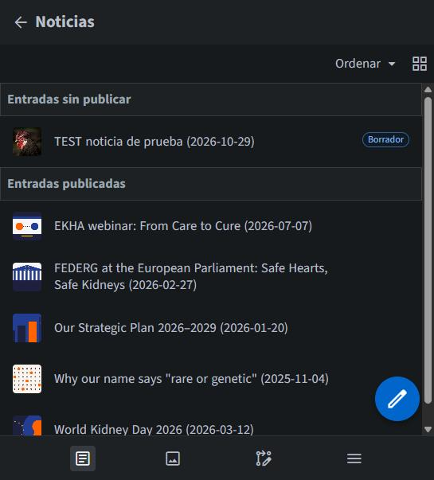
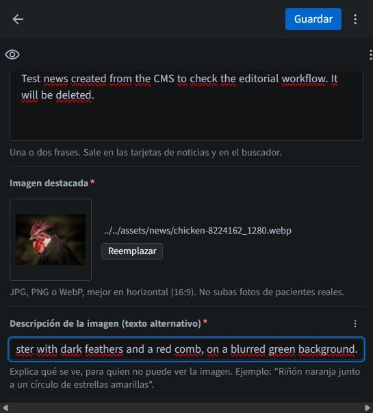
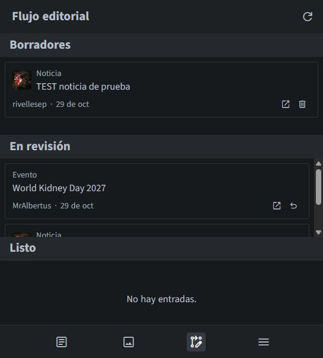
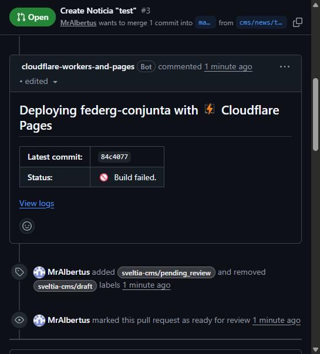

# Guía para editar la web

> **Proyecto de prácticas.** Esta web no es la oficial de FEDERG (la oficial es [federg.org](https://federg.org/)). No publiques nunca datos reales de pacientes ni fotos de personas reales. Las historias de pacientes son siempre inventadas.

Esta guía es para quien va a escribir noticias o cambiar eventos y no ha tocado nunca el código. No hace falta instalar nada: todo se hace desde el navegador.

## Antes de empezar

Necesitas tres cosas:

1. Una cuenta de GitHub. Si no tienes, se crea gratis en [github.com](https://github.com/).
2. Permiso de escritura en el repositorio `rivellesep/federg-conjunta`. Pídeselo a quien lo administra: te llegará una invitación por correo que tienes que aceptar.
3. Activar la verificación en dos pasos en tu cuenta de GitHub. Con tu cuenta se puede cambiar la web entera, así que conviene protegerla bien.

## Cómo funciona, en pocas palabras

Cada cosa que guardas en el editor es un **borrador**. Los borradores no se ven en la web pública, pero cada uno tiene su propia **vista previa**, que es una copia de la web con tu cambio puesto. Cuando el borrador está bien, lo **publicas** y en uno o dos minutos la web pública se actualiza sola.

Por dentro, el editor guarda los borradores en GitHub (cada uno es una "pull request") y Cloudflare construye la web cada vez que algo cambia. No necesitas entender esto para editar, pero te ayudará si algo falla.

## Entrar en el editor

1. Abre [federg-conjunta.pages.dev/admin/](https://federg-conjunta.pages.dev/admin/).
2. Pulsa **Iniciar sesión con GitHub**.
3. Se abre una ventana de GitHub. La primera vez te pedirá permiso para la aplicación del editor: acéptalo. Solo pide acceso a repositorios públicos.
4. Ya estás dentro. A la izquierda verás las colecciones: Noticias, Eventos, Historias de pacientes, Miembros y Páginas.

El navegador recuerda la sesión. Si usas un ordenador compartido, cierra la sesión al terminar desde el círculo con tu foto, arriba a la derecha.

## Crear una noticia con imagen

1. Entra en **Noticias** y pulsa el botón redondo del lápiz (o el **+** de arriba).
2. Rellena los campos. Los que llevan un asterisco rojo son obligatorios:
   - **Título** y **Fecha**. La fecha sale de hoy por defecto.
   - **Resumen**: una o dos frases. Es lo que aparece en las tarjetas y en el buscador.
   - **Imagen destacada**: pulsa **Explorar** o arrastra la imagen desde tu ordenador. Mejor en horizontal. El editor la convierte a WebP y la reduce si es muy grande, así que no hace falta prepararla.
   - **Descripción de la imagen**: explica qué se ve, para las personas que no pueden ver la imagen. Por ejemplo: "Riñón naranja junto a un círculo de estrellas amarillas". Es obligatoria.
   - **Etiquetas**: opcionales. Pulsa Intro después de cada una.
   - **Texto**: el cuerpo de la noticia. Escríbelo en inglés, como el resto de la web.
3. Pulsa **Guardar**. Saldrá un aviso preguntando si quieres enviar la noticia a revisión. Puedes decir que sí o dejarlo para más tarde; en los dos casos el borrador queda guardado.

**Cuidado con las imágenes de otros borradores.** Al elegir una imagen, el editor también enseña las que han subido otras personas en borradores que todavía no se han publicado. Si eliges una de esas, tu noticia apunta a una imagen que aún no existe en la web y la vista previa falla. Nos pasó en la prueba. Sube siempre la imagen desde tu ordenador, con un nombre de archivo que no se repita.

## Modificar un evento

1. Entra en **Eventos** y abre el evento.
2. Cambia lo que haga falta. Si el evento dura un solo día, deja vacía la **Fecha de fin**. La **Web del evento** tiene que empezar por `https://`.
3. Pulsa **Guardar**.

No hace falta mover los eventos que ya han pasado: la web se reconstruye sola cada mañana y los pasa de "Upcoming" a "Past".

## Previsualizar

Hay dos maneras de ver cómo quedará:

- **El ojo** que hay arriba a la izquierda del formulario abre una vista previa dentro del editor. Es rápida pero aproximada.
- **La vista previa real**, que es la web completa con tu cambio. Tarda uno o dos minutos en estar lista después de guardar. Para encontrarla, entra en la [lista de pull requests](https://github.com/rivellesep/federg-conjunta/pulls), abre la de tu borrador y busca el comentario de Cloudflare. El enlace es el de **Branch Preview URL**, con una forma parecida a `cms-events-world-kidney-day.federg-conjunta.pages.dev`.

Si en ese comentario pone **Build failed** en lugar del enlace, el borrador tiene un problema. Mira el apartado "Si falla la publicación".

## Estados de un borrador

Cada borrador pasa por tres estados, que se cambian con el desplegable que hay junto al botón Guardar:

- **Borrador**: lo estás escribiendo.
- **En revisión**: quieres que otra persona lo mire.
- **Listo**: se puede publicar.

El icono de **Flujo editorial** (en la barra de abajo o a la izquierda, según el tamaño de la pantalla) enseña todos los borradores ordenados en esas tres columnas.

## Publicar

1. Abre el borrador y cambia su estado a **Listo**.
2. Aparece el botón **Publicar**. Púlsalo y confirma.
3. Espera uno o dos minutos y recarga la página pública para ver el cambio.

Si la página no cambia, prueba a recargar sin caché (Ctrl+Mayús+R) o espera un poco más. En la prueba vimos que una noticia ya borrada seguía apareciendo un rato en su dirección antigua por la caché de Cloudflare, aunque ya no salía en la lista de noticias.

## Borrar una noticia

1. Abre la noticia y pulsa el menú de los tres puntos **⋮** de arriba a la derecha.
2. Elige **Eliminar** y confirma. La noticia no desaparece todavía: queda marcada como **Pendiente de eliminación**, que es otro borrador.
3. Vuelve a abrirla y pulsa **Eliminar** otra vez. Ahora sí se publica el borrado.

La imagen de la noticia no se borra sola. Si ya no hace falta, se puede borrar desde la **Biblioteca de medios** (el icono de la imagen en la barra).

## Deshacer un cambio

Depende de si el cambio ya está publicado o no.

**Si todavía es un borrador**, lo más fácil es descartarlo. En el **Flujo editorial**, cada borrador tiene un icono de papelera que lo elimina sin tocar la web. Si solo quieres quitar lo que has cambiado en el formulario, el menú **⋮** tiene la opción **Revertir todos los cambios**.

**Si ya está publicado**, hay dos caminos, y ninguno necesita terminal:

- **Desde el editor.** Abre la entrada, deja el texto como estaba y vuelve a guardar y publicar. Es lo más sencillo para cambios pequeños. El menú **⋮** tiene una opción **Historial** donde se pueden consultar los cambios anteriores.
- **Desde la web de GitHub**, para deshacer de golpe todo lo que cambió una publicación:
  1. Entra en la [lista de pull requests cerradas](https://github.com/rivellesep/federg-conjunta/pulls?q=is%3Apr+is%3Aclosed) y abre la del cambio. Tienen títulos como `Update Evento "world-kidney-day-2027"`.
  2. Abajo del todo hay un botón **Revert**. Púlsalo: GitHub prepara una pull request nueva que hace exactamente lo contrario.
  3. En esa pull request nueva, pulsa **Merge pull request** y confirma.
  4. Cloudflare reconstruye la web y en uno o dos minutos vuelve a estar como antes.

## Si falla la publicación

Cada vez que algo cambia, Cloudflare construye la web de nuevo. Si la construcción falla, **la web pública no se rompe**: Cloudflare sigue enseñando la última versión que funcionaba. Lo comprobamos en la prueba: un borrador falló y la web pública siguió igual.

**Dónde se ve el error**

- En un borrador: en su pull request de GitHub, el comentario de Cloudflare pone **Build failed** y al lado del commit sale una cruz roja.
- Después de publicar: en la [lista de commits de main](https://github.com/rivellesep/federg-conjunta/commits/main), el último commit tiene una cruz roja en lugar de una marca verde.
- El detalle del error está en Cloudflare, en Workers & Pages, proyecto `federg-conjunta`, pestaña Deployments, botón **View logs**. Solo lo ven las personas con acceso a esa cuenta de Cloudflare, así que si no lo tienes, avisa a quien administra la web.
- Si falla la reconstrucción de cada mañana, el aviso sale en la pestaña **Actions** del repositorio.

**Causas más habituales**

- Una imagen que no existe, por ejemplo una cogida de otro borrador sin publicar.
- Un campo obligatorio vacío, como el resumen o la descripción de la imagen.
- Una dirección web que no empieza por `https://`.

**Cómo se arregla**

- Si el error está en un borrador, corrígelo en el editor y vuelve a guardar. Cloudflare prueba otra vez solo.
- Si el error ya está publicado, corrígelo en el editor y publica, o deshaz la publicación con el botón **Revert** de GitHub como se explica arriba. Hasta que se arregle, ninguna publicación nueva llegará a la web, porque todas se construyen encima del error.

## Normas de contenido

- Nada de datos reales de pacientes ni de salud. Las historias de pacientes son inventadas y la web lo indica.
- Nada de fotos de personas reales. Usa ilustraciones o fotos sin personas.
- El contenido de la web va en inglés. Las ayudas del editor están en español.
- El formulario de contacto es de demostración y no envía nada. No lo cambies.
