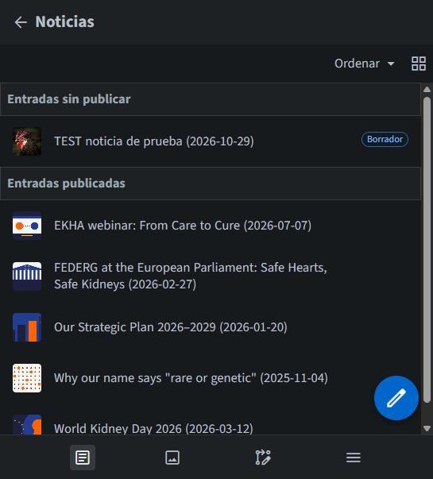
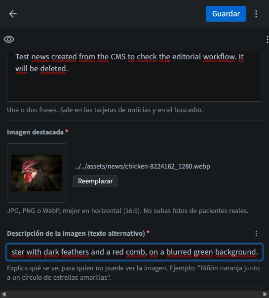
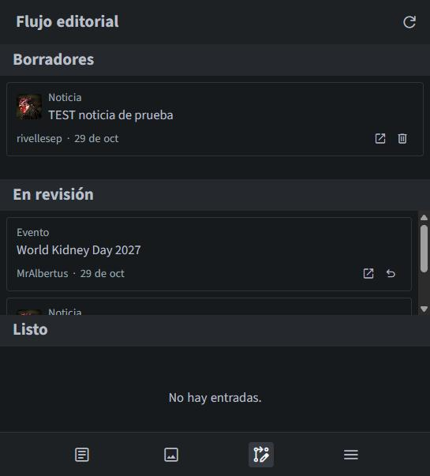

# Guía para editar la web (acceso con email, sin GitHub)

> **Proyecto de prácticas.** Esta web no es la oficial de FEDERG (la oficial es [federg.org](https://federg.org/)). No publiques nunca datos reales de pacientes ni fotos de personas reales. Las historias de pacientes son siempre inventadas.

> **Versión de prueba.** Esta guía es la del editor con acceso por email, que está en pruebas en la rama `sin-github`. La guía del editor con cuenta de GitHub, que es el que usa hoy la web publicada, está en la rama `main`. Mientras dure la prueba, lo que publiques aquí sale en la web de prueba [sin-github.federg-conjunta.pages.dev](https://sin-github.federg-conjunta.pages.dev/), no en la web principal.

Esta guía es para quien va a escribir noticias o cambiar eventos y no ha tocado nunca el código. No necesitas cuenta de GitHub ni instalar nada: todo se hace desde el navegador con tu email.

## Antes de empezar

Solo necesitas una cosa: que quien administra la web haya añadido tu email a la lista de personas que pueden entrar. Si no lo ha hecho, al intentar entrar verás un aviso de que no tienes acceso.

## Cómo funciona, en pocas palabras

Cada cosa que guardas en el editor es un **borrador**. Los borradores no se ven en la web, pero cada uno tiene su propia **vista previa**, que es una copia de la web con tu cambio puesto. Cuando el borrador está bien, lo **publicas** y en uno o dos minutos la web se actualiza sola.

Por dentro, el editor guarda tus cambios en un repositorio de GitHub a través de un "robot" con permiso solo para esta web. Tú no ves GitHub en ningún momento, pero cada cambio queda guardado en el historial con tu nombre o con un código que te identifica, nunca con tu email.

## Entrar en el editor

1. Abre [federg-cms-email.enric-albert-federg.workers.dev/admin/](https://federg-cms-email.enric-albert-federg.workers.dev/admin/).
2. Cloudflare te pide tu email. Escríbelo y pulsa el botón para recibir el código.
3. Te llega un correo con un código de unos pocos números. Cópialo en la página. Si no te llega, mira en la carpeta de spam.
4. Se abre el editor con el título **FEDERG CMS sin GitHub (prueba)**. Pulsa **Iniciar sesión con GitHub**. Sí, pone GitHub, pero **no te pedirá ninguna cuenta**: se abre una ventana un momento, se cierra sola y ya estás dentro.
5. A la izquierda verás las colecciones: Noticias, Eventos, Historias de pacientes, Miembros y Páginas.

El navegador recuerda la sesión durante un tiempo. Si usas un ordenador compartido, cierra la sesión al terminar desde el círculo de arriba a la derecha y cierra el navegador.

## Crear una noticia con imagen

1. Entra en **Noticias** y pulsa **Nuevo** (o el **+** de arriba).
2. Rellena los campos. Los que llevan un asterisco rojo son obligatorios:
   - **Título** y **Fecha**. La fecha sale de hoy por defecto.
   - **Resumen**: una o dos frases. Es lo que aparece en las tarjetas y en el buscador.
   - **Imagen destacada**: pulsa **Explorar** o arrastra la imagen desde tu ordenador. Mejor en horizontal. El editor la convierte y la reduce si es muy grande, así que no hace falta prepararla.
   - **Descripción de la imagen**: explica qué se ve, para las personas que no pueden ver la imagen. Por ejemplo: "Riñón naranja junto a un círculo de estrellas amarillas". Es obligatoria.
   - **Etiquetas**: opcionales. Pulsa Intro después de cada una.
   - **Texto**: el cuerpo de la noticia. Escríbelo en inglés, como el resto de la web.
3. Pulsa **Guardar**. Si sale un aviso preguntando si quieres enviar la noticia a revisión, puedes decir que sí o dejarlo para más tarde. En los dos casos el borrador queda guardado.

**Cuidado con las imágenes de otros borradores.** Al elegir una imagen, el editor también enseña las que han subido otras personas en borradores que todavía no se han publicado. Si eliges una de esas, tu noticia apunta a una imagen que aún no existe en la web y la vista previa falla. Sube siempre la imagen desde tu ordenador, con un nombre de archivo que no se repita.

## Modificar un evento

1. Entra en **Eventos** y abre el evento.
2. Cambia lo que haga falta. Si el evento dura un solo día, deja vacía la **Fecha de fin**. La **Web del evento** tiene que empezar por `https://`.
3. Pulsa **Guardar**.

No hace falta mover los eventos que ya han pasado: la web se reconstruye sola cada mañana y los pasa de "Upcoming" a "Past".

## Previsualizar

Hay dos maneras de ver cómo quedará:

- **El ojo** que hay arriba a la izquierda del formulario abre una vista previa dentro del editor. Es rápida pero aproximada.
- **La vista previa real**, que es la web completa con tu cambio. Tarda uno o dos minutos en estar lista después de guardar. Su dirección se forma con el tipo de contenido y el nombre de la entrada. Por ejemplo, una noticia llamada "TEST email CMS" tiene su vista previa en `cms-news-test-email-cms.federg-conjunta.pages.dev`. El editor debería enseñar también un enlace a esta vista previa junto al borrador.

Si la vista previa no carga después de unos minutos, el borrador puede tener un problema. Mira el apartado "Si falla la publicación".

## Estados de un borrador

Cada borrador pasa por tres estados, que se cambian con el desplegable que hay junto al botón Guardar:

- **Borrador**: lo estás escribiendo.
- **En revisión**: quieres que otra persona lo mire.
- **Listo**: se puede publicar.

El icono de **Flujo editorial** enseña todos los borradores ordenados en esas tres columnas.

## Publicar

1. Abre el borrador y cambia su estado a **Listo**.
2. Aparece el botón **Publicar**. Púlsalo y confirma.
3. Espera uno o dos minutos y recarga la web para ver el cambio.

Si la página no cambia, prueba a recargar sin caché (Ctrl+Mayús+R) o espera un poco más.

## Borrar una noticia

1. Abre la noticia y pulsa el menú de los tres puntos **⋮** de arriba a la derecha.
2. Elige **Eliminar** y confirma. La noticia no desaparece todavía: queda marcada como **Pendiente de eliminación**, que es otro borrador.
3. Vuelve a abrirla y pulsa **Eliminar** otra vez. Ahora sí se publica el borrado.

La imagen de la noticia no se borra sola. Si ya no hace falta, se puede borrar desde la **Biblioteca de medios** (el icono de la imagen en la barra).

## Deshacer un cambio

Depende de si el cambio ya está publicado o no.

**Si todavía es un borrador**, lo más fácil es descartarlo. En el **Flujo editorial**, cada borrador tiene un icono de papelera que lo elimina sin tocar la web. Si solo quieres quitar lo que has cambiado en el formulario, el menú **⋮** tiene la opción **Revertir todos los cambios**.

**Si ya está publicado**, abre la entrada, déjala como estaba y vuelve a guardar y publicar. El menú **⋮** tiene una opción **Historial** donde se pueden consultar los cambios anteriores.

Si el cambio es grande o no sabes cómo dejarlo como estaba, pide ayuda a quien administra la web. Esa persona puede deshacer de golpe cualquier publicación desde GitHub, porque todo queda guardado en el historial.

## Si falla la publicación

Cada vez que algo cambia, Cloudflare construye la web de nuevo. Si la construcción falla, **la web no se rompe**: Cloudflare sigue enseñando la última versión que funcionaba.

**Cómo lo notarás**

- En un borrador: la vista previa no aparece o no carga después de varios minutos.
- Después de publicar: el cambio no aparece en la web aunque hayan pasado más de cinco minutos.

Con este acceso no ves los registros de Cloudflare ni de GitHub, así que si pasa algo de esto, avisa a quien administra la web y dile qué estabas cambiando.

**Causas más habituales**

- Una imagen que no existe, por ejemplo una cogida de otro borrador sin publicar.
- Un campo obligatorio vacío, como el resumen o la descripción de la imagen.
- Una dirección web que no empieza por `https://`.

**Cómo se arregla**

- Si el error está en un borrador, corrígelo en el editor y vuelve a guardar. Cloudflare prueba otra vez solo.
- Si el error ya está publicado, corrígelo en el editor y publica. Hasta que se arregle, ninguna publicación nueva llegará a la web, porque todas se construyen encima del error.

## Normas de contenido

- Nada de datos reales de pacientes ni de salud. Las historias de pacientes son inventadas y la web lo indica.
- Nada de fotos de personas reales. Usa ilustraciones o fotos sin personas.
- El contenido de la web va en inglés. Las ayudas del editor están en español.
- El formulario de contacto es de demostración y no envía nada. No lo cambies.
