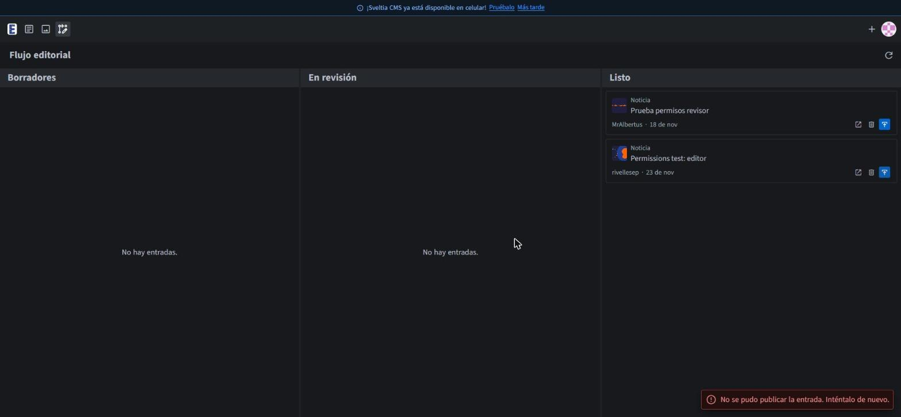
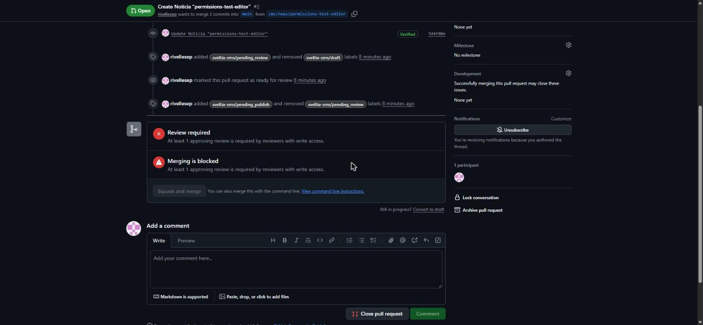
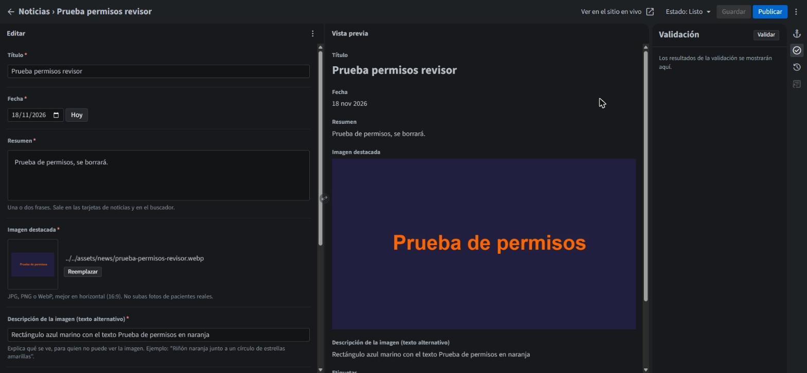
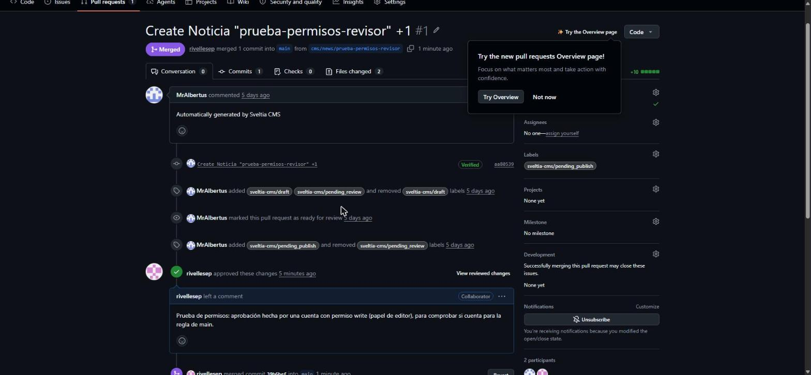

# Quién publica y quién solo propone

Pregunta de la revisión del 29/10: si la web fuera real y la editara la asociación, ¿quién debería poder publicar directamente y quién solo proponer cambios? Cómo montarlo con este stack y qué se rompería del editor. Marcamos cada dato como **probado**, **documentado** o **estimado**.

El 23/11 probamos la propuesta contra una copia del repositorio. Los resultados están en [Resultado de la prueba](#resultado-de-la-prueba-2311) y ya están aplicados en el resto de este documento.

## Cómo está ahora

Sveltia CMS no tiene roles propios: usa los permisos del repositorio de GitHub (documentado). Quien tiene permiso de escritura puede guardar borradores **y** publicarlos; quien no lo tiene no puede ni guardar. Hoy los colaboradores somos Enric y Albert, así que cualquiera de los dos publica sin que nadie revise (probado: así publicamos las pruebas del 29/10).

Para una asociación eso no vale: una persona voluntaria con pocas horas de formación podría publicar un error, o un dato personal, sin que nadie lo vea antes.

## Propuesta: dos papeles

| Papel | Quién | Qué puede hacer | Permiso en GitHub |
| --- | --- | --- | --- |
| Editor | Voluntarios y personal que escribe noticias y eventos | Crear y modificar borradores y marcarlos como **Listo** | Write |
| Revisor | Una o dos personas de confianza, por ejemplo de la junta | Revisar la vista previa, aprobar y publicar | Write o Maintain, y **dueño del código** en `.github/CODEOWNERS` |
| Administrador | Dos personas (titular y suplente, ver [RECUPERACION.md](RECUPERACION.md)) | Cambiar ajustes, permisos y secretos | Owner de la organización |

El permiso de GitHub por sí solo **no separa** a editores y revisores. Para la regla de `main` cuenta la aprobación de cualquiera con permiso Write, y quien tiene Write puede fusionar en cuanto hay una aprobación (probado el 23/11). Lo que distingue a la persona revisora es estar en `CODEOWNERS` con la opción "exigir revisión de los dueños del código" activada (documentado; probado solo en parte, ver la prueba 8).

Para poder separar así a las personas, el repositorio tendría que estar en una **organización de GitHub de la asociación**, con un equipo "editores" y otro "revisores", en lugar de en una cuenta personal como ahora. En un repositorio personal no existe el permiso Maintain: las personas colaboradoras solo pueden tener Write (probado en el repositorio de prueba).

## Cómo se monta

Una regla de protección (*ruleset*) sobre la rama `main`, en Settings → Rules → Rulesets (documentado):

1. **Exigir pull request antes de fusionar**, con **una aprobación** de otra persona. GitHub no deja aprobar la pull request propia, así que siempre la revisa alguien distinto de quien la escribió (probado).
2. **Exigir la revisión de los dueños del código** (*Require review from Code Owners*), con un archivo `.github/CODEOWNERS` que tenga la línea `* @organizacion/revisores`. Sin esto, la aprobación de un editor basta para publicar (probado). Los dueños del código tienen que tener permiso Write en el repositorio (documentado).
3. **Descartar las aprobaciones si el borrador cambia después**, para que no se publique algo distinto de lo que se revisó (probado: la aprobación desapareció dos segundos después del cambio).
4. **Exigir que pase el build de Cloudflare Pages** (Cloudflare publica el resultado como *check run* en cada pull request). Así un borrador roto no puede llegar a la web, como el de la imagen del 29/10, cuyo build falló.
5. **Bloquear los `push --force` y que se pueda borrar `main`**.
6. **Permitir solo fusión con *squash***, que es la que usa el editor (`squash_merges: true` en `public/admin/config.yml`).
7. **Nadie en la lista de excepciones**, o solo los administradores, y solo para emergencias.

Además, verificación en dos pasos obligatoria para todo el mundo en la organización.

## Cómo quedaría el flujo

1. La persona editora crea o cambia una noticia en `/admin/` y la marca como **Listo**.
2. La persona revisora abre la pull request en GitHub, mira la vista previa de Cloudflare y, si está bien, la **aprueba**.
3. La revisora la publica: con el botón de fusionar de GitHub o con **Publicar** en el editor.

Una vez aprobada, la persona editora también puede pulsar **Publicar** y funciona (probado). No es grave, porque lo que se publica es lo que la revisora aprobó, siempre que esté activa la regla 3. Si se quiere que solo publiquen las revisoras, una organización permite limitar quién puede fusionar en `main` (documentado, solo en organizaciones). No lo hemos probado y no sabemos cómo reaccionaría el editor (estimado).

## Qué se rompe del editor

- **El botón Publicar falla para los editores mientras nadie ha aprobado.** El editor publica fusionando la pull request con el token de quien ha iniciado sesión. Si falta la aprobación, GitHub rechaza la fusión. El editor solo dice "No se pudo publicar la entrada. Inténtalo de nuevo.", sin explicar que falta una aprobación (probado). Los editores siguen pudiendo guardar y marcar Listo (probado). Esto hay que contarlo en la guía del editor, porque "inténtalo de nuevo" invita a pulsar otra vez.
- **El editor no enseña la aprobación.** Una entrada aprobada y otra sin aprobar se ven igual: "Estado: Listo" y el botón **Publicar** activo. Hay que mirarlo en GitHub (probado).
- **Borrar también pasa por revisión**, porque un borrado es otro borrador.
- **Los cambios de la revisora necesitan que los apruebe otra persona**, porque nadie puede aprobarse a sí mismo (probado: el borrador de prueba de Albert estuvo cinco días bloqueado hasta que lo aprobó otra persona). Con `CODEOWNERS`, si la revisora es la autora y la única dueña del código, GitHub no le exige su propia revisión y basta con que apruebe cualquier persona con Write, aunque sea un editor (probado, prueba 8). Así sus cambios no se quedan atascados, pero quien los aprueba puede ser un editor.
- **Las urgencias son más lentas**: para retirar algo hace falta que otra persona apruebe. Por eso conviene que haya administradores en la lista de excepciones solo para emergencias, y que quede registrado.
- **El historial de Git no dice quién publicó.** El commit que llega a `main` lleva como autor a quien escribió el borrador. Quién lo aprobó y quién lo publicó solo consta en la pull request (probado).
- **La reconstrucción diaria no se ve afectada**, porque usa el deploy hook y no hace commits en `main` (documentado en `.github/workflows/daily-rebuild.yml`).
- **El permiso del editor sigue siendo amplio**: el token que pide (`public_repo`) sirve para todos los repositorios públicos de esa persona, no solo para este (documentado).

**Con la opción A** (rama `sin-github`), quien guarda y publica en GitHub es la GitHub App, no la persona. Las reglas de `main` se aplicarían igual, pero los papeles habría que comprobarlos en el Worker (qué correos pueden publicar y cuáles solo guardar), porque para GitHub todos los cambios vendrían del mismo robot (estimado).

## Retirar algo con urgencia con las reglas activadas

Con las reglas, retirar un dato personal publicado por error necesita que otra persona apruebe el cambio, y puede que nadie esté disponible en ese momento. Para que una urgencia sea rápida sin saltarse la revisión en el día a día:

1. **Solo los administradores en la lista de excepciones, y solo para pull requests.** En la regla de `main` se añade el rol de administrador a *Bypass list* con la opción *For pull requests only*: un administrador puede fusionar una pull request sin aprobación, pero sigue sin poder subir nada directo a `main`. GitHub deja constancia de cada vez que alguien se salta la regla en *Rule insights* (documentado; no lo hemos probado).
2. **Un procedimiento escrito.** El administrador edita la noticia en el editor, sustituye el contenido por "Contenido retirado" (como explica [CACHE.md](CACHE.md), sobrescribir es más rápido que borrar) y lo publica. Avisa a la revisora, que revisa esa pull request después. La excepción se usa solo para retirar, nunca para publicar contenido nuevo.
3. **Dos administradores**, titular y suplente ([RECUPERACION.md](RECUPERACION.md)), para que siempre haya alguien que pueda hacerlo.
4. **Con dominio propio**, además, una regla de redirección en Cloudflare puede ocultar la dirección al momento sin tocar Git. Después se hace el cambio normal en el repositorio (estimado).

En el día a día no cambia nada: los editores siguen sin poder publicar sin aprobación, y las excepciones quedan registradas y se pueden revisar.

## Resultado de la prueba (23/11)

### Montaje

- **Repositorio de prueba**: `MrAlbertus/federg-permisos-prueba`, una copia espejo pública de este. No tiene Cloudflare Pages conectado, así que no hay vista previa ni build en sus pull requests.
- **Regla `proteger-main`** sobre su rama principal: pull request obligatoria con una aprobación, descartar aprobaciones si hay cambios, solo *squash*, sin `push --force` ni borrado de `main` y nadie en la lista de excepciones.
- **Personas**: Enric (`rivellesep`) con permiso Write, en el papel de editor. Albert (`MrAlbertus`) es el dueño del repositorio, en el papel de revisor.
- **Editor**: la rama `prueba-permisos` de este repositorio apunta `public/admin/config.yml` a la copia. Su vista previa, `prueba-permisos.federg-conjunta.pages.dev/admin/`, trabaja contra la copia con el mismo Worker de acceso.

No se tocó la web publicada ni la rama `main` de este repositorio.

### Pruebas

| # | Qué hicimos | Qué esperábamos | Qué pasó |
| --- | --- | --- | --- |
| 1 | El editor crea la noticia "Permissions test: editor" (pull request #2), la marca Listo y pulsa **Publicar** | Que fallara | Falla. GitHub deja la pull request bloqueada con "At least 1 approving review is required by reviewers with write access." El editor muestra un error genérico. |
| 2 | El revisor crea su propia noticia de prueba (pull request #1) y espera | Que no pudiera aprobársela | Bloqueada cinco días, hasta la prueba 3 |
| 3 | El **editor** aprueba la pull request #1 del revisor | Que su aprobación no contara, porque solo tiene Write | **Cuenta.** La pull request pasa a aprobada y se puede fusionar. |
| 4 | El **editor** publica la pull request #1 desde el editor | Que no pudiera | **Funciona.** La fusiona `rivellesep` (commit `39b6bef` en la copia). |
| 5 | El revisor aprueba la pull request #2 | Que quedara aprobada | Aprobada |
| 6 | Después de la aprobación, el editor cambia el texto de la noticia en el editor | Que la aprobación se retirara (regla 3) | **Se retira.** El editor guardó a las 11:07:05 (UTC) y GitHub descartó la aprobación a las 11:07:07. |
| 7 | El revisor vuelve a aprobar y publica | Que funcionara | **Funciona.** Albert la aprobó de nuevo y la fusionó (pull request #2, 11:09:17). |
| 8 | Añadimos `.github/CODEOWNERS` con `* @MrAlbertus` (pull request #3), activamos *Require review from Code Owners*, el revisor crea una noticia (pull request #4) y el **editor** la aprueba | Que siguiera bloqueada, porque falta la revisión del dueño del código | **No se bloquea:** queda aprobada y se puede fusionar. Albert es el autor y el único dueño del código, y en ese caso GitHub no exige la revisión del dueño. La documentación no menciona esta excepción. |

### Qué cambia en la propuesta

1. **Write y Maintain no separan los papeles.** Las pruebas 3 y 4 muestran que dos editores podrían aprobarse entre sí y publicar sin pasar por un revisor. Proponemos añadir `CODEOWNERS` con el equipo de revisores y activar la revisión obligatoria de los dueños del código (regla 2 de [Cómo se monta](#cómo-se-monta)). La prueba 8 no llega a demostrarlo: con solo dos cuentas, el autor era el propio dueño del código. Según la documentación, el borrador de un editor sí necesitaría que lo aprobara una revisora (**documentado**, sin probar).
2. **La guía del editor tiene que explicar el error al publicar**: si sale "No se pudo publicar la entrada", lo más probable es que falte la aprobación, y reintentar no sirve.
3. **Hace falta un sitio donde la persona revisora vea qué falta por aprobar**, porque el editor no lo enseña. Lo más sencillo es la lista de pull requests de GitHub con el filtro `review:required`.

### Otras cosas que vimos

- El editor dejó guardar un borrador sin el campo obligatorio **Texto** y solo protestó al pasarlo a revisión ("La entrada tiene errores. Corrígelos antes de cambiar el estado."). No tiene que ver con los permisos, pero conviene saberlo.
- **Cambiar la regla pide confirmar la identidad.** Al activar *Require review from Code Owners*, GitHub pidió "Confirm access" y un código enviado al correo de la cuenta antes de guardar (probado). Quien administre necesita acceso a ese correo, otro motivo para que la cuenta vaya a un correo de la asociación ([RECUPERACION.md](RECUPERACION.md)).
- **La copia espejo no se sube limpia con `--mirror`**: las ramas sí, pero GitHub rechaza las referencias de las pull requests y el comando acaba en error. Lo apuntamos en [RECUPERACION.md](RECUPERACION.md).

### Qué falta

1. **Probar `CODEOWNERS` en el caso que importa**: un editor crea un borrador y otro editor lo aprueba. Debería quedarse bloqueado hasta que apruebe una revisora. Hace falta una tercera cuenta con permiso Write que no sea dueña del código.

La limpieza está hecha: la pull request #4 se cerró sin fusionar y se borraron el repositorio de prueba y la rama `prueba-permisos`.

La regla del build de Cloudflare (regla 4) no se puede probar en la copia sin conectarla a un proyecto de Cloudflare Pages. La dejamos como **documentado**.
